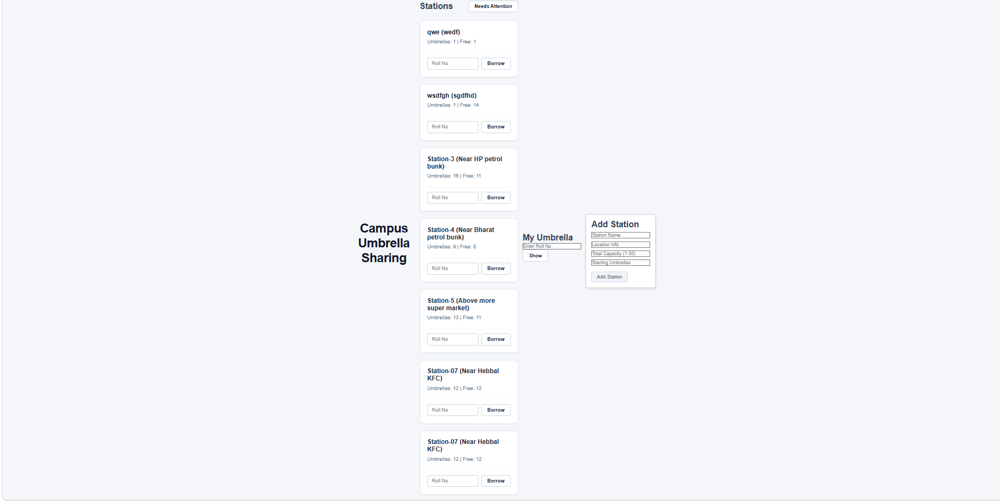

# Team 09 · Adopt-a-Plant

| Team | Partner 1 | Partner 2 | Project | Branch |
|---|---|---|---|---|
| 09 | Kommaddi Fayaz | Ganga Siva Kumar Reddy | [Adopt-a-Plant](https://github.com/nithyasatish28/js-mini-project/blob/main/4-adopt-a-plant.md) | `team-09-plants` |

**Every 3 hours:** update this file, then commit and push it with the message `Check-in Day 1 12:00` (your day and time). Your instructor reads this page on GitHub.

## 1. Who is doing what

Update your own row at every check-in.

| Day | Partner | What will you do? | Completed? | What are you going to work on next? | Stuck on? |
|---|---|---|---|---|---|
| Day 1 | Kommaddi Fayaz | main.py (endpoints) | no | 3 are pending |  |
| Day 1 | Ganga Siva Kumar Reddy |functions.py  | no |3 more function  | yes |
| Day 2 | Kommaddi Fayaz | main.py | no |  |  |
| Day 2 | Ganga Siva Kumar Reddy | functions.py | no | 1 more | yes |
| Day 3 | Kommaddi Fayaz | main.py | yes |  |  |
| Day 3 | Ganga Siva Kumar Reddy | functions.py | yes |  frontend|no  |

## 2. Endpoint tracker

Fill in the method and path from your PRD's endpoint table. Status: ✅ done · 🟡 in progress · ⬜ not started

| # | Method + path | Built | Rules checked in /docs | Connected to React | Who |
|---|---|---|---|---|---|
| E1 | GET /plants  | ✅ | ✅ | ⬜ | Fayaz |
| E2 | GET /plants/{plant_id} | ✅ | ✅ | ⬜ | Fayaz |
| E3 | POST /plants | ✅ | ✅ | ⬜| Fayaz |
| E4 | POST /plants/{plant_id}/adopt | ✅ | ⬜ | ⬜ | Fayaz |
| E5 | DELETE /plants/{plant_id}/adopt | ✅ | ⬜ | ⬜ | Fayaz |
| E6 | POST /plants/{plant_id}/water | ✅ | ⬜ | ⬜ |Fayaz  |
| E7 | GET /plants/needs-water | ✅ | ⬜ | ⬜ | Fayaz |

## 3. Frontend tracker

| Part (from section 5 of your PRD) | Shows the data | Buttons work | Shows API errors | Who |
|---|---|---|---|---|
| Garden | ⬜ | ⬜ | ⬜ |  |
| My plants | ⬜ | ⬜ | ⬜ |  |
| Add a plant | ⬜ | ⬜ | ⬜ |  |

## 4. Blockers and help needed

- 

## 5. How to run our app

Fill this in by the end of Day 2. Someone who has never seen your code should be able to follow it.

**Backend**

```bash
cd backend

```

**Frontend**

```bash
cd frontend

```

## 6. Proof of work

Save a screenshot of `/docs` or your app as `screenshot.png` in this branch. It shows here:


