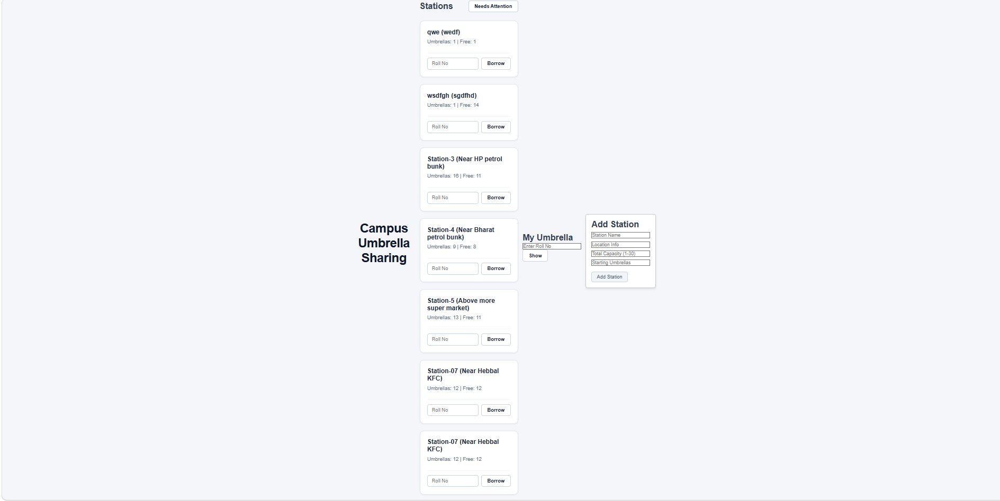

# Team 22 · Campus Event Registration

| Team | Partner 1 | Partner 2 | Project | Branch |
|---|---|---|---|---|
| 22 | shahibha | madiha | [Campus Event Registration](https://github.com/nithyasatish28/js-mini-project/blob/main/22-campus-event-registration.md) | `team-22-events` |

**Every 3 hours:** update this file, then commit and push it with the message `Check-in Day 1 12:00` (your day and time). Your instructor reads this page on GitHub.

## 1. Who is doing what

Update your own row at every check-in.

| Day | Partner | What will you do? | Completed? | What are you going to work on next? | Stuck on? |
|---|---|---|---|---|---|
| Day 1 | shahibha| E1,E2,E3,E4 | Yes | Write main.py ,function.py | no |
| Day 1 | madiha |E5,E6,E7  | yes | Write main.py ,function.py | No |
| Day 2 | shahibha |check if it working   | no | Test all rules in /docs |yes  |
| Day 2 | madiha |Setup frontend folder  | yes  | writing code for frontend |No  |
| Day 3 | shahibha | Writing code for components folder and Final checks|Yes  | Demo | No |
| Day 3 | madiha |final checks |Yes  |Demo  | No |

## 2. Endpoint tracker

Fill in the method and path from your PRD's endpoint table. Status: ✅ done · 🟡 in progress · ⬜ not started

| # | Method + path | Built | Rules checked in /docs | Connected to React | Who |
|---|---|---|---|---|---|
| E1 |GET /events | ✅ | ✅ | ✅ | shahibha |
| E2 |GET /events/{event_id}  | ✅ | ✅ | ✅ | shahibha |
| E3 |POST /events  | ✅ | ✅ | ✅ |shahibha|
| E4 |DELETE /events/{event_id}  | ✅ | ✅ | ✅ | shahibha |
| E5 |POST /events/{event_id}/registrations  | ✅ | ✅ |  ✅ | madiha|
| E6 |GET /registrations/{roll_no} | ✅ | ✅ | ✅ |  madiha |
| E7 |PATCH /registrations/{registration_id}/cancel  | ✅ | ✅ | ✅|  madiha |

## 3. Frontend tracker

| Part (from section 5 of your PRD) | Shows the data | Buttons work | Shows API errors | Who |
|---|---|---|---|---|
| Events | ✅ | ✅ | ⬜ |shahibha and  madiha |
| My events | ✅ | ✅ | ⬜ |  madiha |
| Add an event | ✅ | ✅ | ⬜ |  Shahibha|

## 4. Blockers and help needed

- 

## 5. How to run our app

Fill this in by the end of Day 2. Someone who has never seen your code should be able to follow it.

**Backend**

```powershell
cd backend
py -m venv .venv
.\.venv\Scripts\Activate.ps1
pip install -r requirements.txt
python -m uvicorn main:app --reload
```

Open http://127.0.0.1:8000 for the API status or http://127.0.0.1:8000/docs to try the endpoints.

**Frontend**


```bash
cd frontend
npm install
npm run dev
```

## 6. Proof of work

Save a screenshot of `/docs` or your app as `screenshot.png` in this branch. It shows here:

